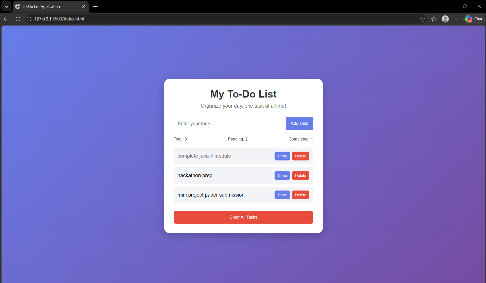

# Ex03 To-Do List using JavaScript
# Date: 17-11-2026
# AIM
To create a To-do Application with all features using JavaScript.

# ALGORITHM
STEP 1
Build the HTML structure (index.html).

STEP 2
Style the App (style.css).

STEP 3
Plan the features the To-Do App should have.

STEP 4
Create a To-do application using Javascript.

STEP 5
Add functionalities.

STEP 6
Test the App.

STEP 7
Open the HTML file in a browser to check layout and functionality.

STEP 8
Fix styling issues and refine content placement.

STEP 9
Deploy the website.

STEP 10
Upload to GitHub Pages for free hosting.

# PROGRAM
# index.html
```

<!DOCTYPE html>
<html lang="en">
<head>
    <meta charset="UTF-8">
    <meta name="viewport" content="width=device-width, initial-scale=1.0">
    <title>To-Do List Application</title>
    <link rel="stylesheet" href="style.css">
</head>
<body>

    <div class="container">
        <h1>My To-Do List</h1>
        <p class="subtitle">Organize your day, one task at a time!</p>

        <div class="input-section">
            <input type="text" id="taskInput"
                   placeholder="Enter your task...">
            <button id="addBtn">Add Task</button>
        </div>

        <div class="task-stats">
            <p>Total: <span id="totalCount">0</span></p>
            <p>Pending: <span id="pendingCount">0</span></p>
            <p>Completed: <span id="completedCount">0</span></p>
        </div>

        <ul id="taskList"></ul>

        <button id="clearBtn" class="clear-btn">
            Clear All Tasks
        </button>
    </div>

    <script src="script.js"></script>
</body>
</html>
```
# style.css
```

* {
    margin: 0;
    padding: 0;
    box-sizing: border-box;
}

body {
    font-family: Arial, sans-serif;
    background: linear-gradient(135deg, #667eea, #764ba2);
    min-height: 100vh;
    display: flex;
    justify-content: center;
    align-items: center;
    padding: 20px;
}

.container {
    background: white;
    width: 100%;
    max-width: 500px;
    padding: 30px;
    border-radius: 15px;
    box-shadow: 0 8px 25px rgba(0, 0, 0, 0.2);
}

h1 {
    text-align: center;
    color: #333;
    margin-bottom: 10px;
}

.subtitle {
    text-align: center;
    color: #777;
    margin-bottom: 25px;
}

.input-section {
    display: flex;
    gap: 10px;
    margin-bottom: 20px;
}

input {
    flex: 1;
    padding: 12px;
    border: 1px solid #ccc;
    border-radius: 6px;
    font-size: 15px;
    min-width: 0;
}

button {
    padding: 12px 16px;
    border: none;
    background: #667eea;
    color: white;
    border-radius: 6px;
    cursor: pointer;
}

button:hover {
    background: #5367cf;
}

.task-stats {
    display: flex;
    justify-content: space-between;
    gap: 8px;
    margin-bottom: 20px;
    font-size: 13px;
    color: #444;
}

#taskList {
    list-style: none;
}

#taskList li {
    display: flex;
    align-items: center;
    justify-content: space-between;
    gap: 10px;
    background: #f3f4f8;
    padding: 12px;
    margin-bottom: 10px;
    border-radius: 6px;
}

.task-text {
    flex: 1;
    overflow-wrap: anywhere;
}

.completed .task-text {
    text-decoration: line-through;
    color: gray;
}

.task-actions {
    display: flex;
    gap: 6px;
}

.task-actions button {
    padding: 7px 10px;
    font-size: 12px;
}

.delete-btn {
    background: #e74c3c;
}

.delete-btn:hover {
    background: #c0392b;
}

.clear-btn {
    width: 100%;
    margin-top: 15px;
    background: #e74c3c;
}

.clear-btn:hover {
    background: #c0392b;
}

@media (max-width: 400px) {
    .container {
        padding: 20px;
    }

    .task-stats {
        flex-wrap: wrap;
    }
}
```
# script.js
```

let tasks = JSON.parse(localStorage.getItem("tasks")) || [];

const taskInput = document.getElementById("taskInput");
const addBtn = document.getElementById("addBtn");
const taskList = document.getElementById("taskList");
const totalCount = document.getElementById("totalCount");
const pendingCount = document.getElementById("pendingCount");
const completedCount = document.getElementById("completedCount");
const clearBtn = document.getElementById("clearBtn");

// Save tasks in Local Storage
function saveTasks() {
    localStorage.setItem("tasks", JSON.stringify(tasks));
}

// Display tasks
function displayTasks() {
    taskList.innerHTML = "";

    tasks.forEach((task, index) => {
        const li = document.createElement("li");

        if (task.completed) {
            li.classList.add("completed");
        }

        const span = document.createElement("span");
        span.className = "task-text";
        span.textContent = task.name;

        const actions = document.createElement("div");
        actions.className = "task-actions";

        const completeBtn = document.createElement("button");
        completeBtn.textContent = task.completed ? "Undo" : "Done";

        completeBtn.addEventListener("click", () => {
            tasks[index].completed = !tasks[index].completed;
            saveTasks();
            displayTasks();
        });

        const deleteBtn = document.createElement("button");
        deleteBtn.textContent = "Delete";
        deleteBtn.className = "delete-btn";

        deleteBtn.addEventListener("click", () => {
            tasks.splice(index, 1);
            saveTasks();
            displayTasks();
        });

        actions.appendChild(completeBtn);
        actions.appendChild(deleteBtn);

        li.appendChild(span);
        li.appendChild(actions);

        taskList.appendChild(li);
    });

    updateCounts();
}

// Add a new task
function addTask() {
    const taskName = taskInput.value.trim();

    if (taskName === "") {
        alert("Please enter a task!");
        return;
    }

    tasks.push({
        name: taskName,
        completed: false
    });

    taskInput.value = "";
    saveTasks();
    displayTasks();
}

// Update task counts
function updateCounts() {
    const completed = tasks.filter(task => task.completed).length;
    const pending = tasks.length - completed;

    totalCount.textContent = tasks.length;
    pendingCount.textContent = pending;
    completedCount.textContent = completed;
}

// Add task on button click
addBtn.addEventListener("click", addTask);

// Add task by pressing Enter
taskInput.addEventListener("keypress", (event) => {
    if (event.key === "Enter") {
        addTask();
    }
});

// Clear all tasks
clearBtn.addEventListener("click", () => {
    if (tasks.length === 0) {
        alert("There are no tasks to clear!");
        return;
    }

    if (confirm("Are you sure you want to delete all tasks?")) {
        tasks = [];
        saveTasks();
        displayTasks();
    }
});

// Initial display
displayTasks();
```
# OUTPUT



# RESULT
The program for creating To-do list using JavaScript is executed successfully.